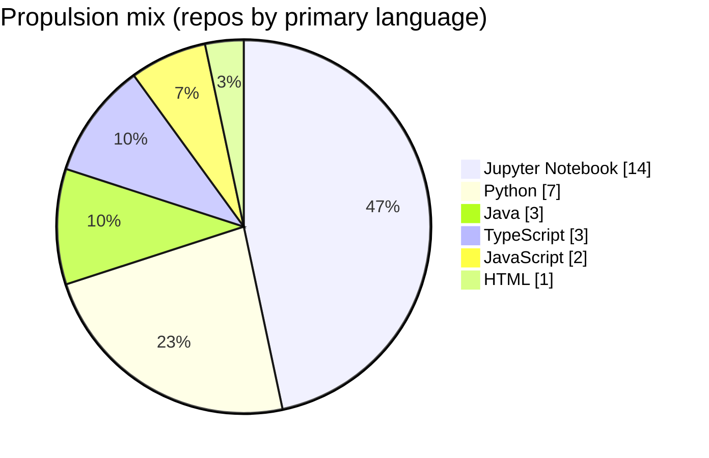

<!-- NAV -->

 

> **`> MISSION BRIEF`**
> Signal acquired. This station builds machines that read, listen and talk back: agents compiled from raw documents, retrieval that doesn't miss, voices on phone lines, models tuned on a single GPU.
> Some missions are public. Most run dark.

## 📡 Live Telemetry

Pulled from the GitHub API every day by <a href=".github/workflows/telemetry.yml">a workflow</a>.

<b>🔍 Open the interactive propulsion chart</b>

 

<!-- CHART:START -->

<!-- CHART:END -->

## 🚀 Active Missions

Click a card to board the mission · <a href="https://github.com/chinmay-sh?tab=repositories">all repositories →</a>

<b>🔒 Classified archive</b> · clearance required

 

<code>~80 repositories on record. Most remain dark. Declassified fragments:</code>

- MCP gateways on Cloudflare Workers that route many backends behind one endpoint
- A LangGraph pipeline that chains two OCR engines to read scanned books
- Voice agents on Vapi and SIP trunks
- `██████ ███ ████████ ██ ███████████`

## ⚙️ Onboard Systems

 

<b>🧠 Intelligence module</b> · agents, retrieval, models

| Subsystem | Hardware |
|---|---|
| Agent protocols | MCP, A2A, FastMCP, OpenAI-compatible APIs |
| Retrieval | Hybrid RAG (vector + BM25 + knowledge graph), RRF, reranking, Pinecone |
| Fine-tuning | LoRA, QLoRA, PEFT, prefix-tuning, Hugging Face Transformers |
| Inference | GPU serving on Modal, vLLM, llama.cpp |
| Voice | LiveKit Agents, Gemini Live, SIP telephony |
| Orchestration | LangGraph, LangChain, LlamaIndex |

<b>🛠️ Flight computer</b> · languages and interfaces

| Subsystem | Hardware |
|---|---|
| Primary | Go, Python 🐍 |
| Secondary | TypeScript, Bash, PowerShell |
| Interfaces | Vue, Astro, Streamlit |
| Low level | x86-64 assembly (for fun) |

<b>☸️ Launch infrastructure</b> · deploy, observe, connect

| Subsystem | Hardware |
|---|---|
| Containers | Docker (multi-arch), Kubernetes (K3s, MicroK8s, Rancher), Helm |
| Pipelines | GitHub Actions, ArgoCD (GitOps), Jenkins |
| Edge & cloud | Cloudflare Workers & R2, Modal, AWS, Azure |
| Observability | Prometheus, Grafana, ELK |
| Networking | MetalLB, NGINX, PfSense, VLANs |

## 📻 Open a Channel

