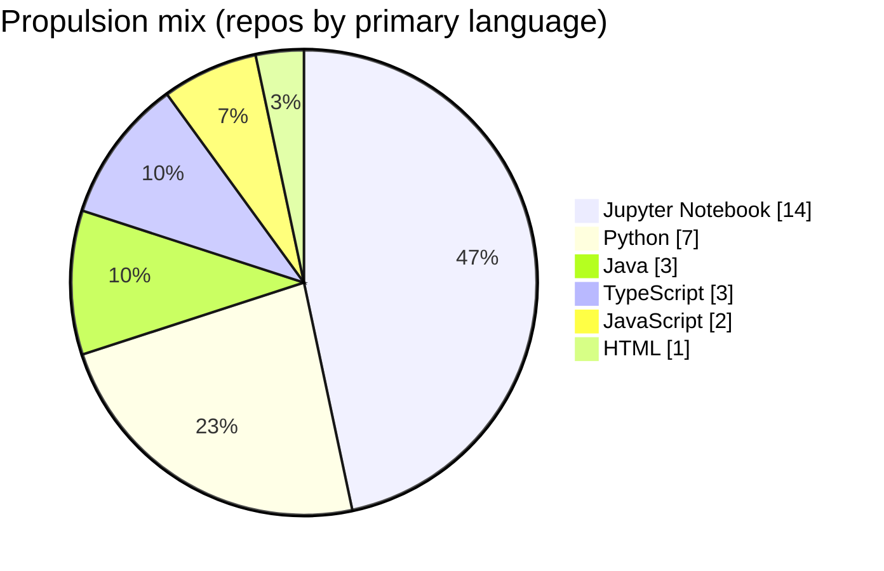
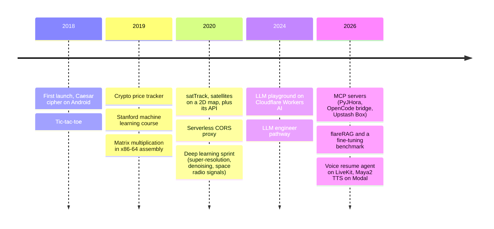

<!-- NAV -->

 

> **`> MISSION BRIEF`**
> I build **AI agents** and the **MCP servers** that let them touch real systems: voice agents on phone lines, coding agents that delegate to other models, and tools served from Cloudflare Workers and Modal GPUs. Before that: computer vision, satellites and a lot of Kubernetes.

## 📡 Live Telemetry

Pulled from the GitHub API every day by <a href=".github/workflows/telemetry.yml">a workflow</a>.

<b>🔍 Open the interactive propulsion chart</b>

 

<!-- CHART:START -->

<!-- CHART:END -->

## 🚀 Active Missions

Click a card to board the mission · <a href="https://github.com/chinmay-sh?tab=repositories">all repositories →</a>

## ⚙️ Onboard Systems

 

<b>🧠 Intelligence module</b> · agents, LLM tooling, ML

| Subsystem | Hardware |
|---|---|
| Agent protocols | MCP, FastMCP, OpenCode |
| Voice | LiveKit Agents, Maya2 TTS |
| Retrieval | RAG pipelines, embeddings |
| Vision & ML | PyTorch, OpenCV, Keras, scikit-learn |

<b>🛠️ Flight computer</b> · languages and interfaces

| Subsystem | Hardware |
|---|---|
| Primary | Python 🐍 |
| Secondary | TypeScript, JavaScript |
| Interfaces | React, Vue / Nuxt, Streamlit |
| Low level | x86-64 Assembly (for fun) |

<b>☸️ Launch infrastructure</b> · deploy, CI/CD, cloud

| Subsystem | Hardware |
|---|---|
| Containers | Docker, Kubernetes |
| Pipelines | GitHub Actions |
| Cloud | AWS, GCP, Cloudflare Workers, Modal |
| Ground ops | Linux administration |

## 🛰️ Flight Log

## 📻 Open a Channel

